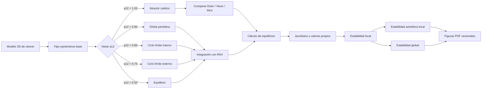

[](https://matlab.mathworks.com/open/github/v1?repo=Hiram20buz/MMP2&file=Santiago_m25210047.mlx)

# Práctica 2 — Caos en sistemas biológicos: métodos numéricos y análisis de estabilidad

Repositorio académico de la asignatura **Gemelos Digitales**, correspondiente a la **Maestría en Ciencias de la Ingeniería** del Tecnológico Nacional de México / Instituto Tecnológico de Tijuana. La práctica compara métodos de diferencias finitas (Euler, Heun y Runge–Kutta) para resolver un sistema no lineal de ecuaciones diferenciales ordinarias de primer orden que exhibe distintos conjuntos compactos invariantes (atractor caótico, órbita periódica, ciclos límite interno y externo, y punto de equilibrio) dependiendo del valor de su parámetro de bifurcación.

El caso de estudio es el modelo tridimensional de cáncer propuesto por Itik y Banks [2], que describe la interacción entre células patológicas, células sanas y células efectoras del sistema inmune. A partir de este sistema se realizan simulaciones numéricas, cálculo de equilibrios, análisis de estabilidad local mediante la matriz Jacobiana y verificación numérica de condiciones de estabilidad asintótica y global.

**Docente:** Dr. Paul Antonio Valle Trujillo

**Departamento:** Ingeniería Eléctrica y Electrónica, Ingeniería Biomédica

**Institución:** Tecnológico Nacional de México / Instituto Tecnológico de Tijuana

**Asignatura:** Gemelos Digitales

**Programa:** Maestría en Ciencias de la Ingeniería

**Alumno:** Ricardo Rioda Santiago Sanchez — m25210047 — m25210047@tectijuana.edu.mx

---

<a id="contenido"></a>
## Contenido

1. [Resumen](#resumen)
2. [Objetivos](#objetivos)
3. [Modelo matemático](#modelo)
4. [Parámetros y dinámicas](#parametros)
5. [Métodos numéricos](#metodos)
6. [Cálculo de equilibrios](#equilibrios)
7. [Análisis de estabilidad local](#estabilidad-local)
8. [Estabilidad asintótica local](#estabilidad-asintotica)
9. [Estabilidad global](#estabilidad-global)
10. [Flujo de trabajo computacional](#flujo)
11. [Actividades y secciones del cuaderno MATLAB](#actividades)
12. [Estructura del repositorio](#estructura)
13. [Requisitos](#requisitos)
14. [Reproducibilidad](#reproducibilidad)
15. [Referencias](#referencias)

---

<a id="resumen"></a>
## Resumen

Esta práctica compara tres métodos numéricos de diferencias finitas (Euler, Heun y Runge–Kutta clásico de cuarto orden) aplicados al modelo tridimensional de cáncer de Itik y Banks. Las simulaciones se realizan para cinco regímenes dinámicos distintos obtenidos variando el parámetro de bifurcación $a_{12}$: atractor caótico, órbita periódica, ciclo límite interno, ciclo límite externo y convergencia hacia un punto de equilibrio.

Posteriormente se calculan los puntos de equilibrio del sistema, se obtienen los valores propios de la matriz Jacobiana evaluada en cada equilibrio y se clasifica su estabilidad local. Finalmente se verifican numéricamente las condiciones de estabilidad asintótica local y las condiciones suficientes de estabilidad global en los distintos regímenes.

**Palabras clave:** sistemas dinámicos no lineales; caos; modelo de cáncer; métodos numéricos; Euler; Heun; Runge–Kutta; estabilidad local; estabilidad global; MATLAB.

[Volver al contenido](#contenido)

---

<a id="objetivos"></a>
## Objetivos

### Objetivo general

Comparar métodos numéricos de diferencias finitas para resolver un sistema no lineal de ODEs de primer orden que exhibe diferentes conjuntos compactos invariantes, y analizar la estabilidad de sus equilibrios a nivel local y global.

### Objetivos específicos

- Implementar los métodos de Euler, Heun y Runge–Kutta clásico de cuarto orden.
- Simular el modelo tridimensional de cáncer para cinco regímenes dinámicos distintos.
- Comparar el comportamiento cualitativo de los tres métodos numéricos sobre el régimen caótico.
- Calcular los puntos de equilibrio del sistema.
- Obtener los valores propios de la matriz Jacobiana y clasificar la estabilidad local de cada equilibrio.
- Verificar numéricamente las condiciones de estabilidad asintótica local.
- Verificar las condiciones suficientes de estabilidad global.
- Exportar las figuras vectoriales de cada simulación como evidencia de los resultados.

[Volver al contenido](#contenido)

---

<a id="modelo"></a>
## Modelo matemático

El sistema está compuesto por tres ecuaciones diferenciales ordinarias no lineales de primer orden:

$$
\dot{x}=r_{1}x(1-b_{1}x)-a_{12}xy-a_{13}xz,
$$

$$
\dot{y}=r_{2}y(1-b_{2}y)-a_{21}xy,
$$

$$
\dot{z}=(r_{3}-a_{31})xz-d_{3}z+\rho_{i}.
$$

Las variables de estado se interpretan de la siguiente forma:

| Variable | Descripción |
|---|---|
| $x(t)$ | Población de células anormales o patológicas |
| $y(t)$ | Población de células normales o sanas |
| $z(t)$ | Población de células efectoras (citotóxicas o NK) |

La dinámica del sistema se localiza en el octante no negativo definido por

$$
\mathbf{R}_{+,0}^{3}=\lbrace x(t)\geq 0,~ y(t)\geq 0,~ z(t)\geq 0\rbrace.
$$

[Volver al contenido](#contenido)

---

<a id="parametros"></a>
## Parámetros y dinámicas

### Parámetros fijos

| Parámetro | Valor | Descripción |
|---|---|---|
| $r_{1}$ | 1 | Tasa de crecimiento de las células patológicas |
| $b_{1}$ | 1 | Capacidad de carga máxima de las células patológicas |
| $a_{13}$ | 2.5 | Fracción de células patológicas eliminadas por células efectoras |
| $r_{2}$ | 0.6 | Tasa de crecimiento de las células sanas |
| $b_{2}$ | 1 | Capacidad de carga máxima de las células sanas |
| $a_{21}$ | 1.5 | Fracción de células sanas eliminadas por las células patológicas |
| $r_{3}$ | 3 | Tasa de reclutamiento máximo de células efectoras |
| $a_{31}$ | 0.3 | Fracción de células efectoras inactivadas por las células patológicas |
| $d_{3}$ | 0.4 | Tasa de muerte de las células efectoras |
| $\rho_{i}(t)$ | — | Tratamiento de inmunoterapia |

### Parámetro de bifurcación

El parámetro $a_{12}\in[0,1]$ representa la fracción de células patológicas eliminadas por las células sanas. Al variar su valor, el sistema exhibe cinco regímenes dinámicos cualitativamente distintos:

| $a_{12}$ | Dinámica | Intervalo temporal | Condiciones iniciales $(x_{0},y_{0},z_{0})$ |
|:---:|---|:---:|---|
| 1.00 | Atractor caótico | $[0,1000]$ | $(0.555,~0.148,~0.172)$ |
| 0.90 | Órbita periódica | $[0,500]$ | $(0.254781,~0.115167,~0.600527)$ |
| 0.80 | Ciclo límite interno | $[0,500]$ | $(0.2,~0.6,~0.1)$ |
| 0.75 | Ciclo límite externo | $[0,500]$ | $(0.4,~0.2,~0.4)$ |
| 0.50 | Convergencia a equilibrio | $[0,500]$ | $(0.5,~0.5,~0.4)$ |

[Volver al contenido](#contenido)

---

<a id="metodos"></a>
## Métodos numéricos

El cuaderno compara tres métodos explícitos de diferencias finitas aplicados al régimen caótico, y utiliza Runge–Kutta clásico de cuarto orden como método de referencia para los cuatro regímenes restantes.

### Método de Euler

Para un sistema $\dot{\mathbf{X}}=\mathbf{F}(\mathbf{X})$,

$$
\mathbf{X}_{n+1}=\mathbf{X}_{n}+h~\mathbf{F}(\mathbf{X}_{n}).
$$

### Método de Heun (Euler mejorado)

$$
\widetilde{\mathbf{X}}_{n+1}=\mathbf{X}_{n}+h~\mathbf{F}(\mathbf{X}_{n}),
$$

$$
\mathbf{X}_{n+1}=\mathbf{X}_{n}+\tfrac{h}{2}\left[\mathbf{F}(\mathbf{X}_{n})+\mathbf{F}(\widetilde{\mathbf{X}}_{n+1})\right].
$$

### Método de Runge–Kutta clásico de cuarto orden

$$
k_{1}=\mathbf{F}(\mathbf{X}_{n}),\qquad
k_{2}=\mathbf{F}(\mathbf{X}_{n}+\tfrac{h}{2}k_{1}),
$$

$$
k_{3}=\mathbf{F}(\mathbf{X}_{n}+\tfrac{h}{2}k_{2}),\qquad
k_{4}=\mathbf{F}(\mathbf{X}_{n}+h~k_{3}),
$$

$$
\mathbf{X}_{n+1}=\mathbf{X}_{n}+\tfrac{h}{6}\left(k_{1}+2k_{2}+2k_{3}+k_{4}\right).
$$

### Figuras generadas

| Archivo | Método | Dinámica |
|---|---|---|
| `Simulaciones numericas/Euler_Chaos.pdf` | Euler | Atractor caótico |
| `Simulaciones numericas/Heun_Chaos.pdf` | Heun | Atractor caótico |
| `Simulaciones numericas/Runge-Kutta_Chaos.pdf` | Runge–Kutta | Atractor caótico |
| `Simulaciones numericas/Runge-Kutta_Orbit.pdf` | Runge–Kutta | Órbita periódica |
| `Simulaciones numericas/Runge-Kutta_CycleI.pdf` | Runge–Kutta | Ciclo límite interno |
| `Simulaciones numericas/Runge-Kutta_CycleE.pdf` | Runge–Kutta | Ciclo límite externo |
| `Simulaciones numericas/Runge-Kutta_Equilibrium.pdf` | Runge–Kutta | Convergencia a equilibrio |

[Volver al contenido](#contenido)

---

<a id="equilibrios"></a>
## Cálculo de equilibrios

Los puntos de equilibrio satisfacen

$$
r_{1}x(1-b_{1}x)-a_{12}xy-a_{13}xz=0,
$$

$$
r_{2}y(1-b_{2}y)-a_{21}xy=0,
$$

$$
(r_{3}-a_{31})xz-d_{3}z+\rho_{i}=0.
$$

El cálculo numérico de los equilibrios se realiza para cada uno de los cinco regímenes dinámicos. Para cada valor de $a_{12}$ el sistema puede presentar un conjunto diferente de equilibrios, los cuales se almacenan en las figuras:

| Archivo | Régimen |
|---|---|
| `Simulaciones numericas/Equilibria_Atractor.pdf` | Atractor caótico |
| `Simulaciones numericas/Equilibria_Orbit.pdf` | Órbita periódica |
| `Simulaciones numericas/Equilibria_CycleI.pdf` | Ciclo límite interno |
| `Simulaciones numericas/Equilibria_CycleE.pdf` | Ciclo límite externo |
| `Simulaciones numericas/Equilibria_Equilibrium.pdf` | Convergencia a equilibrio |

[Volver al contenido](#contenido)

---

<a id="estabilidad-local"></a>
## Análisis de estabilidad local

La matriz Jacobiana del sistema es

$$
J(x,y,z)=\begin{bmatrix} r_{1}(1-2b_{1}x)-a_{12}y-a_{13}z & -a_{12}x & -a_{13}x \\\\ -a_{21}y & r_{2}(1-2b_{2}y)-a_{21}x & 0 \\\\ (r_{3}-a_{31})z & 0 & (r_{3}-a_{31})x-d_{3} \end{bmatrix}.
$$

Para cada equilibrio $E_{i}=(x_{i},y_{i},z_{i})$ se evalúa $J(E_{i})$, se obtienen sus valores propios $\lambda_{1},\lambda_{2},\lambda_{3}$ y se clasifica su estabilidad local según los signos de las partes reales:

- Si $\mathrm{Re}(\lambda_{i})<0$ para todo $i$: equilibrio **asintóticamente estable**.
- Si existe $\mathrm{Re}(\lambda_{i})>0$: equilibrio **inestable**.
- En otro caso: estabilidad **no concluyente** por linealización.

[Volver al contenido](#contenido)

---

<a id="estabilidad-asintotica"></a>
## Estabilidad asintótica local

Las condiciones numéricas de estabilidad asintótica local se verifican para los cinco regímenes dinámicos. Para el régimen caótico, el análisis se realiza introduciendo un término de inmunoterapia $\rho_{i}$ que estabiliza uno de los equilibrios del sistema.

| Archivo | Régimen |
|---|---|
| `Simulaciones numericas/Stability_Atractor.pdf` | Atractor caótico (con inmunoterapia $\rho_{i}$) |
| `Simulaciones numericas/Stability_Orbit.pdf` | Órbita periódica |
| `Simulaciones numericas/Stability_CycleI.pdf` | Ciclo límite interno |
| `Simulaciones numericas/Stability_CycleE.pdf` | Ciclo límite externo |
| `Simulaciones numericas/Stability_Equilibrium.pdf` | Convergencia a equilibrio |

[Volver al contenido](#contenido)

---

<a id="estabilidad-global"></a>
## Estabilidad global

Las condiciones suficientes de estabilidad global del sistema se verifican numéricamente para los cinco regímenes:

| Archivo | Régimen |
|---|---|
| `Simulaciones numericas/Global_Atractor.pdf` | Atractor caótico |
| `Simulaciones numericas/Global_Orbit.pdf` | Órbita periódica |
| `Simulaciones numericas/Global_CycleI.pdf` | Ciclo límite interno |
| `Simulaciones numericas/Global_CycleE.pdf` | Ciclo límite externo |
| `Simulaciones numericas/Global_Equilibrium.pdf` | Convergencia a equilibrio |

[Volver al contenido](#contenido)

---

<a id="flujo"></a>
## Flujo de trabajo computacional



[Volver al contenido](#contenido)

---

<a id="actividades"></a>
## Actividades y secciones del cuaderno MATLAB

El archivo `Santiago_m25210047.mlx` constituye el cuaderno computacional principal. Las actividades siguen todas las secciones y subsecciones del documento.

### 1. Información general

- Nombre del alumno.
- Número de control.
- Correo institucional.
- Asignatura: Gemelos Digitales.
- Docente.

### 2. Datos de la simulación

- Definición de parámetros fijos.
- Definición del parámetro de bifurcación $a_{12}$.
- Condiciones iniciales por régimen.

### 3. Comparación de métodos numéricos

#### 3.1 Atractor caótico

- Método de Euler.
- Método de Heun.
- Método de Runge–Kutta.

#### 3.2 Órbita periódica

- Método de Runge–Kutta.

#### 3.3 Ciclo límite interno

- Método de Runge–Kutta.

#### 3.4 Ciclo límite externo

- Método de Runge–Kutta.

#### 3.5 Punto de equilibrio

- Método de Runge–Kutta.

### 4. Cálculo de equilibrios

- Equilibrios numéricos para cada régimen.

### 5. Equilibrios numéricos y estabilidad local

- Atractor caótico.
- Órbita periódica.
- Ciclo límite interno.
- Ciclo límite externo.
- Equilibrio.

### 6. Condiciones de estabilidad asintótica local

- Atractor caótico (con término de inmunoterapia $\rho_{i}$).
- Órbita periódica.
- Ciclo límite interno.
- Ciclo límite externo.
- Equilibrio.

### 7. Condiciones de estabilidad global

- Atractor caótico.
- Órbita periódica.
- Ciclo límite interno.
- Ciclo límite externo.
- Equilibrio.

### 8. Funciones

- Métodos numéricos.
- Soluciones y trayectorias.
- Parámetros y condiciones iniciales.

[Volver al contenido](#contenido)

---

<a id="estructura"></a>
## Estructura del repositorio

```text
.
├── README.md
├── CITATION.cff
├── LICENSE
├── Santiago_m25210047.mlx           # Cuaderno computacional principal
├── Santiago_m25210047.pdf           # Documento académico
└── Simulaciones numericas/          # Figuras vectoriales generadas por MATLAB
    ├── Euler_Chaos.pdf
    ├── Heun_Chaos.pdf
    ├── Runge-Kutta_Chaos.pdf
    ├── Runge-Kutta_Orbit.pdf
    ├── Runge-Kutta_CycleI.pdf
    ├── Runge-Kutta_CycleE.pdf
    ├── Runge-Kutta_Equilibrium.pdf
    ├── Equilibria_Atractor.pdf
    ├── Equilibria_Orbit.pdf
    ├── Equilibria_CycleI.pdf
    ├── Equilibria_CycleE.pdf
    ├── Equilibria_Equilibrium.pdf
    ├── Stability_Atractor.pdf
    ├── Stability_Orbit.pdf
    ├── Stability_CycleI.pdf
    ├── Stability_CycleE.pdf
    ├── Stability_Equilibrium.pdf
    ├── Global_Atractor.pdf
    ├── Global_Orbit.pdf
    ├── Global_CycleI.pdf
    ├── Global_CycleE.pdf
    └── Global_Equilibrium.pdf
```

Los PDFs se generan con `exportgraphics(...,'ContentType','vector')` durante las simulaciones y análisis del cuaderno. La convención de nombres es `<Grupo>_<Dinámica>.pdf`, donde:

- **Grupo** indica la etapa del análisis: `Euler`, `Heun`, `Runge-Kutta`, `Equilibria`, `Stability`, `Global`.
- **Dinámica** indica el régimen simulado: `Chaos`, `Atractor`, `Orbit`, `CycleI`, `CycleE`, `Equilibrium`.

[Volver al contenido](#contenido)

---

<a id="requisitos"></a>
## Requisitos

Para ejecutar todas las secciones del repositorio se requiere:

- MATLAB.
- Symbolic Math Toolbox (para el cálculo simbólico del Jacobiano y de los equilibrios).

[Volver al contenido](#contenido)

---

<a id="reproducibilidad"></a>
## Reproducibilidad

Para reproducir la práctica completa:

1. Abrir `Santiago_m25210047.mlx` en MATLAB (o directamente en MATLAB Online con el badge superior).
2. Ejecutar la sección **Datos de la simulación** para fijar parámetros y condiciones iniciales.
3. Ejecutar **Comparación de métodos numéricos** para cada régimen dinámico.
4. Ejecutar **Cálculo de equilibrios** y verificar los equilibrios obtenidos.
5. Ejecutar **Equilibrios numéricos y estabilidad local** para cada régimen.
6. Ejecutar **Condiciones de estabilidad asintótica local** para los regímenes no caóticos.
7. Ejecutar **Condiciones de estabilidad global** para los cinco regímenes.
8. Conservar las figuras PDF generadas en `Simulaciones numericas/` como evidencia.

### Resultados mínimos esperados

Al finalizar la práctica, el repositorio debe contener o permitir generar:

- Comparación cualitativa de Euler, Heun y Runge–Kutta sobre el régimen caótico.
- Simulaciones Runge–Kutta para los cinco regímenes dinámicos.
- Lista numérica de los equilibrios de cada régimen.
- Tabla de valores propios y clasificación de estabilidad local por equilibrio.
- Verificación numérica de las condiciones de estabilidad asintótica local.
- Verificación numérica de las condiciones de estabilidad global.
- Figuras vectoriales PDF para cada etapa del análisis.

[Volver al contenido](#contenido)

---

<a id="referencias"></a>
## Referencias

[1] P. A. Valle, *Syllabus para Biología de Sistemas y Gemelos Digitales*, Tecnológico Nacional de México / Instituto Tecnológico de Tijuana, Tijuana, B.C., México, 2026. Disponible en: https://biomath.xyz/course/

[2] M. Itik y S. P. Banks, "Chaos in a three-dimensional cancer model," *International Journal of Bifurcation and Chaos*, vol. 20, no. 1, pp. 71–79, 2010. https://doi.org/10.1142/S0218127410025417

[3] K. Bryan, *Differential Equations: A Toolbox for Modeling the World*. SIMIODE, 2022. Disponible en: https://www.simiode.org/resources/8307

---

## Uso académico

Este repositorio se utiliza con fines docentes en la asignatura **Gemelos Digitales** de la **Maestría en Ciencias de la Ingeniería**. El cuaderno computacional debe complementarse con la interpretación matemática de los resultados; la ejecución del código por sí sola no sustituye el análisis del sistema dinámico.
